# Network Traffic Analyzer

[](https://github.com/morganwhite-dev/NetworkTrafficAnalyzer/actions/workflows/ci.yml)


[](LICENSE)

**A live look at what my Mac is actually saying on the network.** When something looks off, the part of the network that's causing it turns red.

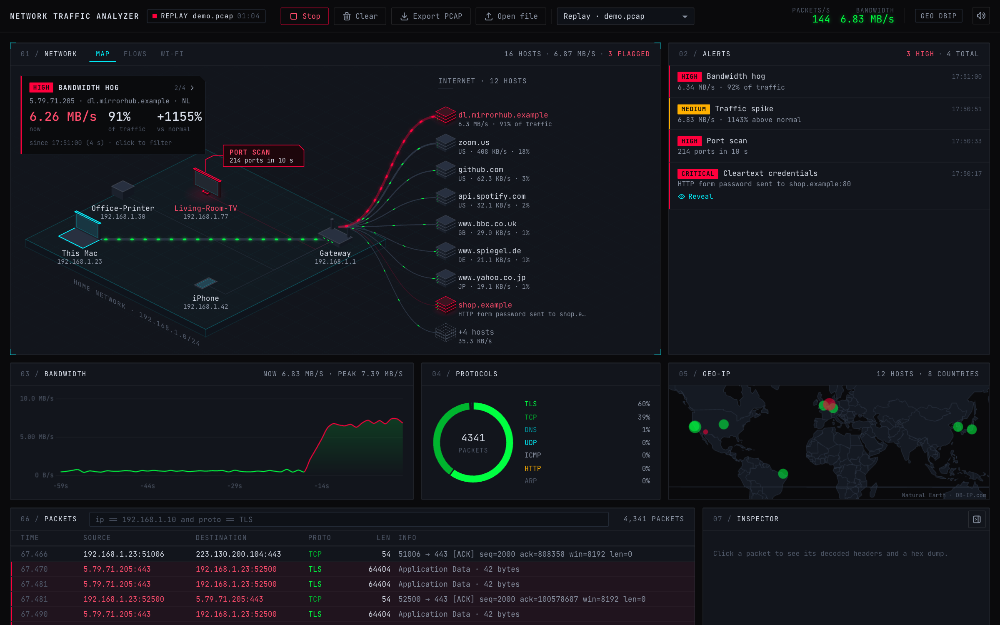

**[Watch the 90-second demo video](docs/demo/network-traffic-analyzer-demo.mp4)**: recorded on a real, live capture of my own Mac, not the staged demo data above.

**Jump to:** [Features](#features) · [Run it](#get-it-running-on-macos) · [Docker](#docker-optional) · [Screenshots](#screenshots) · [Filters](#filter-cheat-sheet) · [Documentation](#documentation) · [Project structure](#project-structure)

## Why I built it

I wanted to see what my Mac is actually doing on the network in real time. Wireshark can answer that, but it's a wall of packets, and I wanted something I could glance at. So I built a dashboard that captures my Mac's traffic live and draws my home network as a little 3D map: my Mac, the router, the other devices on my Wi-Fi, and every server on the internet I'm talking to. Normal traffic flows along the lines in green. When something's wrong (one server hogging the bandwidth, a device scanning my ports, a password going out without encryption), that node turns red and a card in the corner tells me what happened in plain words.

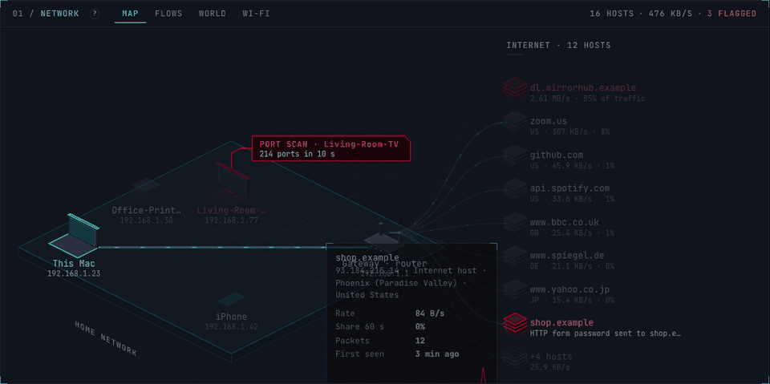

## Features

- **Live packet capture** on any macOS interface (Wi-Fi `en0` by default), plus a **demo replay** that needs no root at all, with a **Live | Demo switch** in the top bar so you can flip between your real traffic and the demo without restarting
- **Built to be understood:** a `?` guide explaining every panel, colour and protocol; hover help on the numbers, tabs and table headings; "what it means / what to do" on every alert; and a first-run hint
- **Counts you can trust:** checked against macOS's own interface counters, it catches about 99.5% of the packets of a heavy download, and shows a **MISSED** counter in the top bar if it ever falls behind
- **Isometric network map:** this Mac, the router, home devices and internet hosts, with packets flowing along each link at a speed that matches the real throughput
- **Flows view:** ribbons sized by each host's share of your bandwidth, so a hog is obvious at a glance
- **Wi-Fi check:** signal strength plus how fast your router and the internet answer, turned into one plain answer: weak signal, busy Wi-Fi, Wi-Fi hiccups, or a slow internet connection (works without capture permission)
- **Threat and anomaly alerts** that turn the guilty node red: port scans, host sweeps, passwords sent in cleartext, traffic spikes, bandwidth hogs, ARP/NDP spoofing, DNS tunneling, rogue DHCP servers and routers, and VPN leaks ([what each one means](docs/DETECTIONS.md))
- **Protocol parsing** for TCP, UDP, ICMP, DNS, mDNS, DHCP, HTTP, TLS (with the server name from the handshake), QUIC and ARP, with timestamps, addresses, ports, lengths and flags
- **Filter bar** with a small query language: `ip == 192.168.1.10`, `proto == TLS and len > 1000`, `port == 53 || port == 443` ([cheat sheet](docs/FILTERS.md))
- **Packet inspector** with a one-line plain summary, decoded headers and a Hex/ASCII dump. Bytes are tinted by layer, and passwords are blurred until you click.
- **World tab:** a Geo-IP map of where your servers are, working offline (no API key and no lookups leaving your Mac)
- **Upload a `.pcap` / `.pcapng`** to analyse it, and **export the session** as a `.pcap` for Wireshark
- **One Traffic panel:** a bandwidth chart that goes red during a spike, with a protocol-share bar underneath (hover a colour for what the protocol means)
- **Packet details drawer** at the bottom of the window: closed by default, it opens by itself, filtered, when you click a device or an alert
- **Synthesized sound cues** (Web Audio, no audio files) when capture starts or a high-severity alert fires, with a mute toggle that remembers your choice
- **Built to be safe to run:** root only for a split second, a per-launch access token, a strict CSP, and hostile-file handling ([details](SECURITY.md))

## Tech stack

| Layer               | What I used                                                                                          |
| ------------------- | ---------------------------------------------------------------------------------------------------- |
| Capture and parsing | Python, [Scapy](https://scapy.net/) (BPF on macOS)                                                   |
| Server              | [FastAPI](https://fastapi.tiangolo.com/), WebSockets, uvicorn                                        |
| Dashboard           | HTML, Tailwind CSS (compiled), vanilla JavaScript modules                                            |
| Charts and map      | [Chart.js](https://www.chartjs.org/), [Leaflet](https://leafletjs.com/) with a Natural Earth outline |
| Network view        | Hand-built isometric SVG, no 3D library                                                              |
| Geo-IP              | [DB-IP](https://db-ip.com/) City Lite offline database (or ip-api.com, opt-in)                       |
| Packaging           | Python venv, Docker, docker compose                                                                  |
| CI                  | GitHub Actions: ruff, pytest, Node tests, pip-audit, CodeQL, gitleaks                                |

## Get it running on macOS

You'll need Python 3.11 or newer (`brew install python` if you don't have it).

```bash
git clone https://github.com/morganwhite-dev/NetworkTrafficAnalyzer.git
cd NetworkTrafficAnalyzer
scripts/setup.sh --geoip
```

That creates a `.venv`, installs hash-checked dependencies (plus Apple's CoreWLAN bindings for Wi-Fi signal readings), and downloads the offline Geo-IP database (about 57 MB). Leave off `--geoip` if you don't want the map.

### Try the demo first (no root needed)

```bash
scripts/run.sh --replay samples/demo.pcap --loop
```

You don't have to launch it that way. Any normal launch has a **Demo** button in the top bar that switches to the same demo (and **Live** switches back).

Open the link it prints (it looks like `http://localhost:8000/?t=…`). The demo is 90 seconds of made-up home traffic on a loop. Around 20 seconds in, a login form goes out over plain HTTP. At 35 seconds the "smart TV" port-scans the Mac, and at 50 seconds one server starts hogging the bandwidth.

### Capture your own traffic

Live capture reads raw packets from `/dev/bpf*`, which macOS only lets root touch by default. You have two options.

**Option 1 (recommended): ChmodBPF.** This is the small helper Wireshark uses. It gives your user read access to the capture devices, so the app never needs root:

```bash
brew install --cask wireshark-chmodbpf
```

Log out and back in once, then:

```bash
scripts/run.sh
```

**Option 2: sudo.**

```bash
sudo scripts/run.sh
```

Here's why `sudo` is reasonably safe here: the app only needs root to _open_ the capture device. Right after that it switches back to your user, checks that it can't get root back, and only then starts the web server. Nothing that parses packets or talks to your browser ever runs as root. The catch is that you pick the interface at startup (`sudo scripts/run.sh --iface en5`).

Either way, the link printed in your terminal contains a one-time token. The dashboard won't open without it, which keeps other websites and other users on your Mac from reading your traffic through `localhost`.

### Open it like a normal Mac app

Typing a command every time gets old, so there's a real app too:

```bash
scripts/install_app.sh
```

That puts **Network Traffic Analyzer** (with its own icon) in `~/Applications`. Open it from Spotlight (`Cmd+Space`, type "Network Traffic") or drag it into your Dock. It starts the analyzer, opens the dashboard and begins capturing on Wi-Fi right away. Clicking it again while it's running brings the dashboard back, and **Quit** from the Dock stops everything. The first time, macOS may ask to let it access your Desktop folder if that's where the project lives.

Live capture from the app needs ChmodBPF (Option 1 above). Logs go to `~/Library/Logs/NetworkTrafficAnalyzer.log`, and `scripts/install_app.sh --remove` deletes the app.

### Handy flags

| Flag                         | Does                                                                        |
| ---------------------------- | --------------------------------------------------------------------------- |
| `--iface en0`                | interface to capture on                                                     |
| `--replay FILE --loop`       | play a capture back in real time                                            |
| `--geo off` / `--geo ip-api` | turn the map off, or use the online lookup (sends public IPs to ip-api.com) |
| `--port 8000`                | dashboard port                                                              |
| `--wifi-target 1.1.1.1` | what the Wi-Fi check pings to time the internet |
| `--open` / `--start` | open the dashboard in your browser / start live capture right away |

## Docker (optional)

```bash
docker compose up
```

Then open the link from `docker compose logs`. The container runs the demo and accepts `.pcap` uploads.

One thing to know: **Docker on a Mac can't capture your Mac's Wi-Fi.** Docker Desktop runs containers inside a Linux virtual machine, so `en0` doesn't exist in there. Use Docker for the demo and for analysing files, and run the app directly for live capture. On a **Linux** machine, live capture in Docker works:

```bash
NTA_IFACE=eth0 docker compose --profile linux-capture up capture
```

That profile uses host networking, keeps the dashboard on `127.0.0.1`, and only adds the `NET_RAW` capability. The default service runs read-only with every capability dropped.

## Screenshots

|                                                                                                     |                                                                                                                               |
| --------------------------------------------------------------------------------------------------- | ----------------------------------------------------------------------------------------------------------------------------- |
| 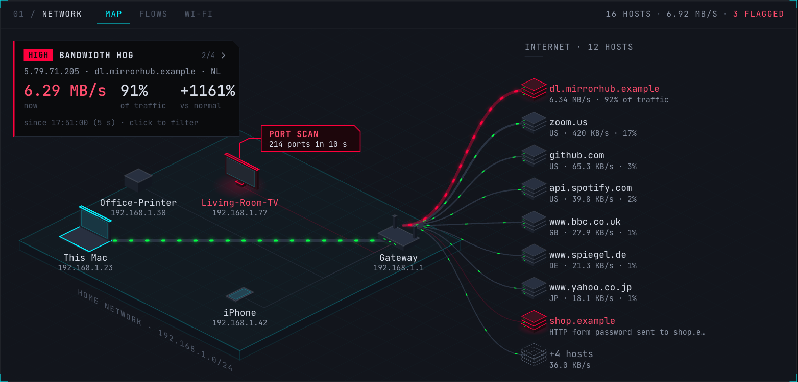 **Map:** your network in 3D. Red means look here.  | 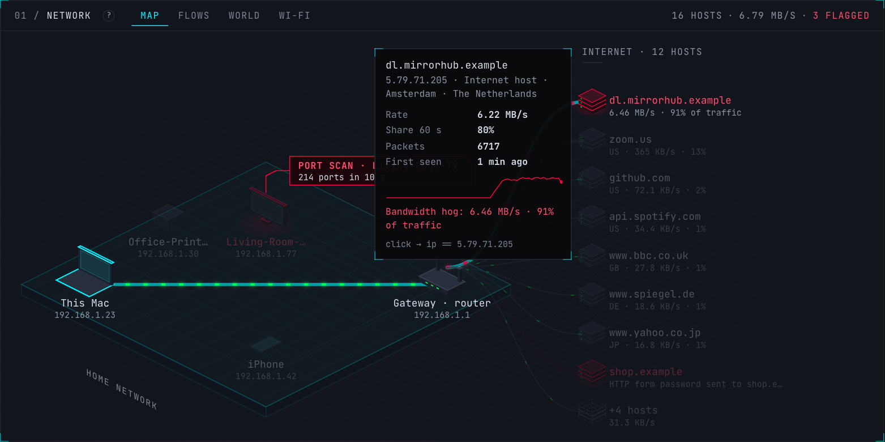 **Hover a host** for its rate, share, first-seen time and a 60 s sparkline. |
| 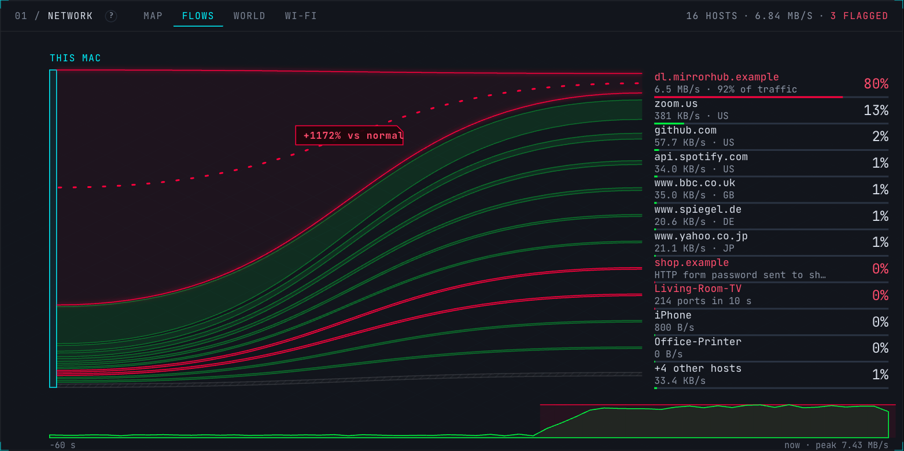 **Flows:** who's using your bandwidth, sized by share. | 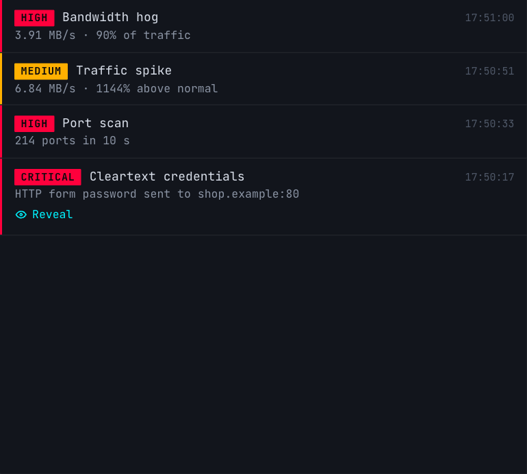 **Alerts** in plain words: open one for the numbers, what it means and what to do.                         |
| 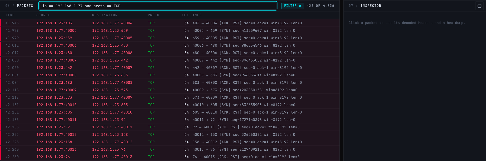 **Filter** to one device and protocol.                       | 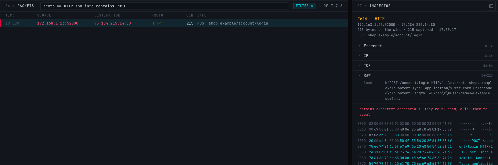 **Inspector** with decoded layers and a Hex/ASCII dump.                          |
| 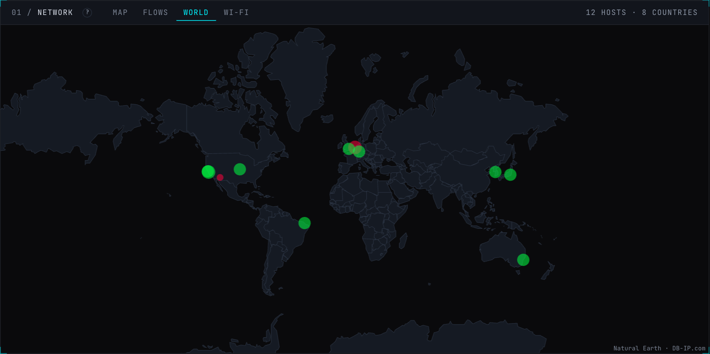 **World:** where the servers you talk to are. | 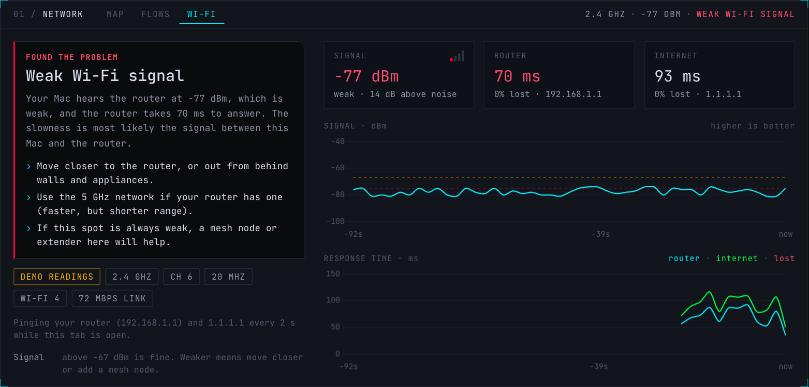 **Wi-Fi check:** one plain answer about why it's slow (demo readings shown). |
| 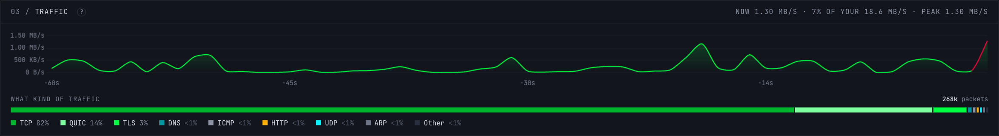 **Traffic:** bandwidth and what kind of traffic it is. | 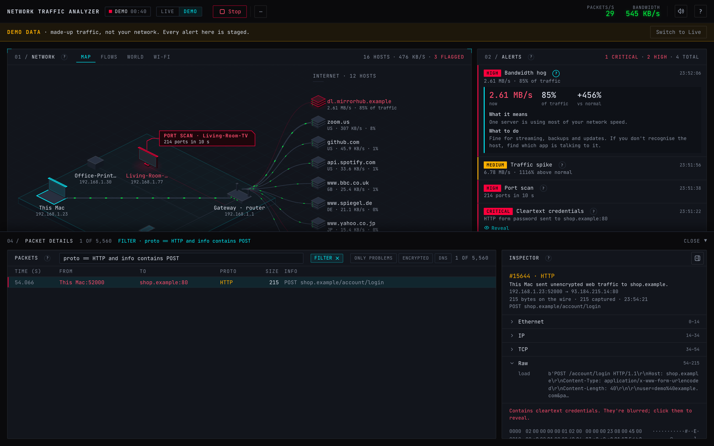 **Packet details** slides up from the bottom when you click a device or alert. |

Every screenshot comes from the bundled demo capture and synthetic Wi-Fi readings, so none of them show a real network. To regenerate them, start the demo with `NTA_TOKEN=demo-screenshots-0123 NTA_WIFI_DEMO=1` (tokens must be at least 16 characters) and run `scripts/capture_screenshots.py`.

## Everyday uses

- **Figuring out why the Wi-Fi is slow.** Open the Wi-Fi tab while it feels slow. It tells you whether it's the signal (move closer), the Wi-Fi being busy or spiky (another device or a crowded channel), or the internet past your router (modem or provider).
- **Checking for VPN leaks.** Connect your VPN and capture on `en0`. Nearly everything should go to your VPN server. Anything else gets flagged as a possible leak.
- **Finding what's eating your bandwidth.** The Flows tab ranks every host by share. Spot the hog, click it, and the packet table filters down to that host.
- **Catching logins without encryption.** Any password, token or cookie sent over plain HTTP, FTP, POP3, IMAP or SMTP shows up as a critical alert (masked until you click Reveal).
- **Seeing what your smart devices do.** TVs, printers and speakers show up on the map with their own names, so you can see who they talk to.
- **Analysing a `.pcap`.** Open a capture from Wireshark or `tcpdump` with "Open file" and get the same map, alerts and charts in a couple of seconds.
- **Learning how networking actually works.** Watch a DNS lookup, a TLS handshake and a page load happen live, then inspect each one byte by byte.

## Filter cheat sheet

| Type                               | To see                                                            |
| ---------------------------------- | ----------------------------------------------------------------- |
| `ip == 192.168.1.10`               | anything to or from one address                                   |
| `ip == 10.0.0.0/8`                 | a whole range                                                     |
| `proto == TLS`                     | encrypted web traffic (`TCP` and `UDP` include everything on top) |
| `port == 53`                       | DNS                                                               |
| `len > 1400`                       | big packets                                                       |
| `info contains "Client Hello"`     | new TLS connections and the sites they're for                     |
| `not proto == TLS and dport == 80` | plain web requests                                                |

More in [docs/FILTERS.md](docs/FILTERS.md).

## Documentation

| Read this                                          | For                                                                  |
| -------------------------------------------------- | -------------------------------------------------------------------- |
| [docs/ARCHITECTURE.md](docs/ARCHITECTURE.md)       | how it works: threads, messages, endpoints, limits, the frontend     |
| [docs/DETECTIONS.md](docs/DETECTIONS.md)           | every alert, what triggers it, and what is usually harmless          |
| [docs/FILTERS.md](docs/FILTERS.md)                 | the packet filter language                                           |
| [docs/DESIGN.md](docs/DESIGN.md)                   | the visual design: the 3D map, page layout, colours and motion       |
| [docs/TROUBLESHOOTING.md](docs/TROUBLESHOOTING.md) | permissions, interfaces, an empty map, Docker on a Mac               |
| [SECURITY.md](SECURITY.md)                         | how it protects you, and how to report a vulnerability               |
| [scripts/README.md](scripts/README.md)             | what each script does                                                |

## How it works

One Python process captures packets on a background thread, analyses them on a second thread, and streams batched updates to the browser over a WebSocket every 200 ms. The dashboard never parses packets itself. It just draws what it's told. [docs/ARCHITECTURE.md](docs/ARCHITECTURE.md) has the diagram and the details.

## Project structure

```text
NetworkTrafficAnalyzer/
├── backend/
│   ├── app/              the server: capture, parsing, detectors, host tracker, Geo-IP, FastAPI app
│   └── tests/            pytest suite: parser, API and security, detectors, store, Geo-IP, Wi-Fi
├── frontend/
│   ├── index.html        the single page
│   ├── css/              app.css (hand-written) and the compiled Tailwind file
│   ├── js/               the dashboard, one small module per panel (see docs/ARCHITECTURE.md)
│   ├── vendor/           Chart.js, Leaflet, icons, fonts and the world outline, with SHA-256 checksums
│   └── tests/            Node tests: filters, layout maths, glossary, charts, world outline
├── docs/
│   ├── *.md              architecture, detections, filters, design, troubleshooting
│   ├── screenshots/      the pictures in this README (scripts/capture_screenshots.py)
│   └── demo/             the demo video (scripts/record_demo.py)
├── scripts/              setup, run, install the Mac app, Geo-IP download, demo, screenshot and video tools
├── samples/demo.pcap     90 s of synthetic traffic behind the Demo button
├── assets/               app icon (SVG source, PNG and .icns)
├── .github/              CI, CodeQL and Dependabot
├── Dockerfile and docker-compose.yml
├── requirements*.in/.txt hash-pinned Python dependencies (.in is what I chose, .txt is the lock)
├── package.json          dev-only: compiles Tailwind and copies the vendored libraries
└── pyproject.toml        project metadata, pytest and ruff settings
```

## Development

```bash
scripts/setup.sh                                  # venv + hash-checked dependencies
.venv/bin/pip install --require-hashes -r requirements-dev.txt   # test and lint tools
.venv/bin/pytest                                  # backend tests
node --test "frontend/tests/*.test.mjs"           # frontend tests (filters, layout, glossary, charts)
.venv/bin/ruff check backend scripts              # lint
scripts/verify_vendor.sh                          # vendored libraries still match their checksums
npm install && npm run build:css                  # only if you change Tailwind classes
```

CI runs the same checks, plus `pip-audit`, CodeQL and a secret scan. If something doesn't work, [docs/TROUBLESHOOTING.md](docs/TROUBLESHOOTING.md) covers the usual suspects.

## Please use it responsibly

Only capture traffic on networks you own or have permission to monitor. Capturing other people's traffic without consent is illegal in a lot of places (wiretapping laws), even on a shared Wi-Fi. This is a tool for understanding your own network.

## License and credits

MIT, see [LICENSE](LICENSE).

Geo-IP data by [DB-IP.com](https://db-ip.com) (CC BY 4.0). World outline from [Natural Earth](https://www.naturalearthdata.com/) via world-atlas (public domain). Icons from [Tabler Icons](https://tabler.io/icons) (MIT). Font: [JetBrains Mono](https://www.jetbrains.com/lp/mono/) (OFL). Charts by Chart.js (MIT), map by Leaflet (BSD-2).

<details>
<summary>Build log</summary>

- [x] Phase 1: project scaffold (pinned, hash-checked dependencies; Scapy 2.8 on Python 3.14)
- [x] Phase 2: packet parser and store (parser, byte-capped ring buffer, PCAP export, credential masking, tests)
- [x] Phase 3: capture and WebSocket API (live/replay capture, root drop, token, Host/Origin checks, CSP)
- [x] Phase 4: threat detectors and host tracker
- [x] Phase 5: Geo-IP lookup (offline DB-IP, opt-in ip-api)
- [x] Phase 6: dashboard UI
- [x] Phase 7: isometric network view (Map and Flows)
- [x] Phase 8: Docker and CI
- [x] Phase 9: docs, screenshots and README
- [x] Phase 10: map labels sized to their neighbours (long IPv6 addresses no longer collide), Live | Demo switch
- [x] Phase 11: clarity pass from a design review: in-app guide, one tooltip system, plain-English alert explainers, friendly names in the packet table, quick filters, readable dim text, compact incident card, collision-aware map callouts
- [x] Phase 12: fixes from a security review of the switch: a paused demo can't leak a packet into the next source, and only an explicit `replay` ever selects the demo
- [x] Phase 13: hardening from the same review: headers-only export really is headers only, source switches are serialised and recover from a failed Live start, inspector fields are masked before they are shortened, other local web pages can't borrow the session cookie (`Sec-Fetch-Site`), tokens must be 16+ characters, a DEMO DATA strip and `nta-demo-` export names, the Docker capture profile drops root, refreshed screenshots
- [x] Phase 14: one-screen layout: Geo-IP became the World tab, Bandwidth and Protocols merged into one Traffic panel, Packets and Inspector moved into a Packet details drawer that opens by itself, the incident card moved into the alert rows, Clear/Save/Open moved under a ⋯ menu, and the world outline no longer draws lines across the map
- [x] Phase 15: a live-capture demo video of the new layout, recorded by `scripts/record_demo.py`, which blurs other devices and refuses to finish if one slips through unblurred; the Mac's own IPv6 address now shows as "This Mac", and every dialog is centred

</details>
