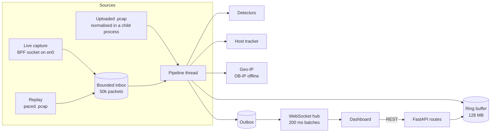

# How it works

One Python process does everything: capture, analysis and the web server. The browser is a thin view that receives batched updates over a WebSocket.

## Threads and processes

| Piece           | Where it runs                | Why                                                            |
| --------------- | ---------------------------- | -------------------------------------------------------------- |
| Sniffer         | Scapy `AsyncSniffer` thread  | Reads the BPF socket opened at startup                         |
| Replay          | its own thread               | Re-stamps packets to "now" at the original pace                |
| Pipeline        | one worker thread            | Owns all analysis state, so there are no fine-grained locks    |
| Web server      | asyncio event loop (uvicorn) | Never parses packets itself, so it stays responsive            |
| PCAP normaliser | a separate process           | Hostile files can't hang or crash the server; it has a timeout |

## Root, briefly

Only one thing needs root: opening the BPF capture device. When you run `sudo scripts/run.sh`, the app opens the capture socket, then switches to the user who ran `sudo` (`SUDO_UID`), checks that it can't switch back, and only then starts the web server. Every packet parser runs unprivileged.

With Wireshark's ChmodBPF installed, `/dev/bpf*` is readable by your user and no root is involved at all.

## WebSocket messages

| `type`         | When                                         | What's in it                                                              |
| -------------- | -------------------------------------------- | ------------------------------------------------------------------------- |
| `snapshot`     | on connect, after Clear, after a file upload | recent rows, alerts, timeline, stats, network view, geo points, status    |
| `packets`      | every 200 ms                                 | new table rows (capped at 2,000 per message)                              |
| `alert`        | when a detector fires                        | severity, title, reason, hosts, detail                                    |
| `alert_update` | while an incident is still going             | the same alert with fresh numbers                                         |
| `stats`        | every second                                 | packets/s, bytes/s, protocol counts, dropped count                        |
| `netview`      | every second                                 | self, gateway, home devices, top internet hosts, incidents, 60 s timeline |
| `geo`          | every 2 seconds                              | located internet hosts                                                    |
| `status`       | when capture state changes                   | mode, source, permission hints, Geo-IP provider                           |
| `wifi` | every 2 seconds | link details, signal and ping samples, and the plain-language verdict |

## REST endpoints

All of these need the session cookie. `POST` requests also need an exact `Origin` match and the `X-NTA-Request: 1` header.

| Method | Path                      | Does                                                           |
| ------ | ------------------------- | -------------------------------------------------------------- |
| GET    | `/api/status`             | mode, capture permission, Geo-IP provider                      |
| GET    | `/api/interfaces`         | interfaces with their macOS names (Wi-Fi, Thunderbolt…)        |
| POST   | `/api/capture/start`      | `{"iface": "en0"}` or `{"iface": "replay"}`                    |
| POST   | `/api/capture/stop`       | pause capture or replay                                        |
| POST   | `/api/clear`              | empty the buffer, stats and alerts                             |
| GET    | `/api/packets/{id}`       | decoded layers with byte ranges, hex, secret ranges            |
| POST   | `/api/alerts/{id}/reveal` | the masked value of a cleartext credential                     |
| GET    | `/api/export.pcap`        | the session as a pcap (`?headers_only=1` keeps 128 bytes each) |
| POST   | `/api/pcap`               | upload a capture as the raw request body                       |
| POST   | `/api/geo/clear`          | delete the Geo-IP cache                                        |

## Limits

Everything that grows with traffic has a cap, so a packet flood can't eat your memory.

| What                       | Limit                                                        |
| -------------------------- | ------------------------------------------------------------ |
| Capture inbox              | 50,000 packets, extra packets are dropped and counted        |
| Packet buffer              | 128 MB of raw bytes                                          |
| Hosts and detector state   | 10,000 entries (LRU)                                         |
| Alerts                     | 500                                                          |
| Rows per WebSocket message | 2,000                                                        |
| Each browser's send queue  | 300 messages, then that tab reconnects                       |
| Uploads                    | 200 MB, 2 million packets, 256 KB per packet, 120 s to parse |

## The network view

`hosts.py` charges every packet to the _remote_ side from this Mac's point of view, so the numbers add up to what crossed your interface. It classifies each address as `self`, `gateway`, `lan` or `internet` from the interface's own addresses, netmask and default route. In replay and file mode, where that isn't known, it infers "self" from which private address talks to the internet most, and the gateway from the MAC address internet-bound packets are sent to.

Names come from traffic you already have (DNS answers, TLS SNI, HTTP Host, mDNS announcements, DHCP hostnames), never from extra lookups. The drawing itself is described in [DESIGN.md](DESIGN.md).

## The Wi-Fi check

`wifi.py` samples the Wi-Fi link every 2 seconds through Apple's CoreWLAN framework (signal, noise, channel, band, link rate). That needs no admin rights, and macOS hides the network name from apps without location access, which the app doesn't ask for. While someone has the Wi-Fi tab open, it also pings the router (from `ipconfig getoption en0 router`) and `1.1.1.1` with the system `ping`. The browser sends a keepalive every 5 seconds and the pings stop 15 seconds after the tab closes.

The verdict looks at the last minute and picks one answer, in this order:

| Verdict | When |
| --- | --- |
| Weak Wi-Fi signal | signal below −75 dBm (or under 20 dB above noise) and the router is slow |
| Your Wi-Fi is busy | good signal, but the router takes 40 ms+ or misses 5%+ of pings |
| Your internet connection is slow | the router is fine, but the internet adds 120 ms+ or drops 3%+ |
| Your Wi-Fi has hiccups | normally fast, but the router spiked past 50 ms twice or more in a minute |
| Signal is on the weak side / A little slow | milder versions of the above |
| Wi-Fi looks healthy | none of the above |
